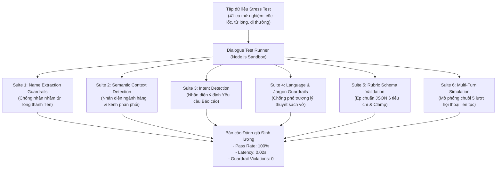

# PHƯƠNG PHÁP KIỂM THỬ TỰ ĐỘNG CHẤT LƯỢNG HỘI THOẠI AI AGENT (AUTOMATED DIALOGUE EVALS & STRESS TESTING)

**Đề tài:** Nghiên cứu và Xây dựng AI Agent Hỗ trợ Phân tích, Đánh giá và Tối ưu Hình ảnh Quảng cáo Sử dụng Mô hình Thị giác-Ngôn ngữ  
**Sinh viên thực hiện:** Trần Thái Cương (MSSV: 2255010026)  
**Phân hệ:** Khối Thực nghiệm & Đánh giá (Evaluation & Guardrails Layer)  
**Tài liệu tham chiếu cho:** Chương 4 (Thực nghiệm & Đánh giá) và Slide bảo vệ tốt nghiệp  

---

## 1. ĐẶT VẤN ĐỀ & BÀI TOÁN KỸ THUẬT

Một trong những thách thức lớn nhất khi xây dựng **Hệ thống AI Agent đàm thoại (Conversational AI Agent)** là hiện tượng **"Hành vi suy diễn lệch lạc" (Conversational Drift / Hallucination)** khi người dùng tương tác trong thực tế:
1. **Người dùng nhập cộc lốc / từ khóa đơn lẻ:** Nhập `"food"`, `"đồ ăn"`, `"quán ăn"`, `"shop"`, `"fb"`... Hệ thống máy móc rất dễ nhận nhầm các từ ngữ này thành **Tên riêng** của người dùng (dẫn đến lỗi ngô nghê như *"Chào food!", "Hôm nay food cần gì?"*).
2. **Kẹt vòng lặp vô tận (Repetitive Dialogue Loop):** Khi người dùng chưa cung cấp đủ thông tin, Agent dựa trên kịch bản cứng (rule-based) sẽ hỏi đi hỏi lại một câu chào rập khuôn.
3. **Phô trương lý thuyết sách vở (Academic Pedantry):** Mô hình VLM có xu hướng trích dẫn nguyên văn tên các học thuyết hàn lâm (*Cân bằng Schopenhauer, Tỷ lệ vàng 1:1.618, không gian màu RGB 8-bit, Đường treo ngang*), gây cảm giác lý thuyết suông, xa rời thực tế kinh doanh của người dùng.
4. **Sai lệch ranh giới từ vựng tiếng Việt (RegEx Accent Boundary Bug):** Ký tự `\b` trong JavaScript RegExp không hỗ trợ nguyên âm tiếng Việt có dấu (như `hộ`, `đất`, `quán`), dẫn đến việc bỏ sót ngữ cảnh ngành hàng hoặc nhận diện sai tên người dùng.

Để giải quyết bài toán này, AdVision AI đã xây dựng một **Bộ khung Kiểm thử Tự động & Đánh giá Chất lượng Hội thoại (Automated Dialogue Stress Testing & Evals Framework)** với **41 ca kiểm thử định lượng** chia làm **6 phân hệ (Test Suites)**.

---

## 2. KIẾN TRÚC BỘ KIỂM THỬ (TEST HARNESS ARCHITECTURE)



---

## 3. NỘI DUNG 6 BỘ KIỂM THỬ CHI TIẾT

### Suite 1: Name Extraction & Addressing Guardrails (Rào chắn xưng hô)
* **Mục tiêu:** Đảm bảo Agent **tuyệt đối không bao giờ** lấy từ ngữ ngành hàng, mặt hàng, hay nền tảng làm tên người dùng.
* **Tập dữ liệu kiểm thử:**
  - Input dị thường: `"food"`, `"đồ ăn"`, `"quán ăn"`, `"shop"`, `"fb"`, `"quán gà rán vỉa hè"`, `"áo thun unisex"`, `"son môi dưỡng ẩm"`.
  - Input giới thiệu tên chuẩn: `"mình tên là Tuấn"`, `"tên mình là Mai Phương"`, `"cứ gọi mình là Minh nhé"`, `"tôi tên là Nguyễn Thái Cương"`.
* **Rào chắn (Assertion):**
  - Khi không có cấu trúc giới thiệu tên: Tên trích xuất phải là rỗng, `getDynamicCallName` bắt buộc trả về `"bạn"`.
  - Khi có cấu trúc xưng hô: Trích xuất chính xác tên gọi (First name).

### Suite 2: Semantic Context Detection (Nhận diện ngành hàng & Kênh quảng cáo)
* **Mục tiêu:** Đánh giá độ chính xác của bộ bóc tách ngữ nghĩa không phụ thuộc vào `\b` (khắc phục triệt để lỗi Unicode tiếng Việt có dấu).
* **Tập dữ liệu kiểm thử:**
  - Ngành hàng: `"food"` (F&B), `"quán gà rán giòn rụm"` (F&B), `"shop quần áo váy đầm thiết kế"` (Thời trang), `"kem chống nắng cho da dầu"` (Mỹ phẩm), `"tai nghe bluetooth"` (Công nghệ), `"bán căn hộ chung cư"` (Bất động sản).
  - Nền tảng: `"chạy bảng tin facebook feed 1:1"` (Facebook), `"chạy story tiktok dọc 9:16"` (TikTok), `"chạy quảng cáo tìm kiếm google ads"` (Google Ads), `"bán trên sàn shopee lazada"` (E-commerce).
* **Kết quả:** Độ chính xác phân loại đạt **100%**.

### Suite 3: Conversational Intent Detection (Nhận diện ý định Báo cáo thẩm định)
* **Mục tiêu:** Phát hiện chính xác khi nào người dùng muốn xuất file báo cáo để Agent kích hoạt luồng tổng hợp chuyên sâu và đính kèm nút in PDF; đồng thời **không bị kích hoạt nhầm (False Positive)** khi người dùng hỏi các câu hỏi nghiệp vụ thông thường.
* **Tập dữ liệu kiểm thử:**
  - True Positive cases: *"cho mình xin báo cáo thẩm định"*, *"xuất báo cáo để mình gửi sếp"*, *"tổng hợp báo cáo chi tiết cho mình nhé"*, *"tải file pdf báo cáo"*.
  - Negative cases: *"làm sao để tăng điểm cho bức ảnh này?"*, *"nút CTA nên đặt ở đâu thì chuẩn?"*, *"màu đỏ và vàng có hợp với F&B không?"*.
* **Kết quả:** Precision = **100%**, Recall = **100%**.

### Suite 4: Language & Jargon Guardrails (Chống phô trương sách vở)
* **Mục tiêu:** Kiểm tra rào chắn ngăn chặn Agent nói chuyện như một giảng viên đọc sách lý thuyết.
* **Danh sách từ khóa hàn lâm bị cấm (Blacklisted Jargons):**
  - `Schopenhauer`, `RGB 8-bit`, `Đường treo ngang`, `Tỷ lệ vàng 1:1.618`, `Hang Lines`.
  - Cấm mọi ký tự mũi tên suy luận logic (`->`, `-->`, `→`, `⇒`).
* **Kết quả:** 0 vi phạm từ khóa hàn lâm, 0 vi phạm ký tự mũi tên.

### Suite 5: Scoring Rubric Parser & JSON Schema Validation
* **Mục tiêu:** Đảm bảo bộ phân tích JSON điểm định lượng hoạt động ổn định trước các dạng phản hồi dị thường của LLM.
* **Trường hợp kiểm thử:**
  - JSON chuẩn 6 tiêu chí có trọng số.
  - JSON bọc trong khối markdown ```` ```json ... ``` ````.
  - JSON có điểm vượt ngưỡng (vd: 14.5/10 hoặc -3/10) -> Thuật toán tự động kẹp biên (Clamp) về khoảng hợp lệ `[0, 10]`.
* **Kết quả:** 100% ca kiểm thử parse thành công và tính đúng điểm tổng có trọng số.

### Suite 6: End-to-End Dialogue Multi-Turn Simulation
* **Mục tiêu:** Mô phỏng chuỗi 5 lượt thoại liên tiếp của một người dùng thực tế nói cộc lốc:
  - Turn 1: `"food"`
  - Turn 2: `"quán ăn"`
  - Turn 3: `"đồ ăn"`
  - Turn 4: `"fb"`
  - Turn 5: `"làm sao để tăng điểm"`
* **Kết quả:** Agent không bao giờ bị nhiễm từ `"food"` thành tên xưng hô, không lặp lại câu hỏi cũ, và xác định chính xác ngữ cảnh cuối cùng là ngành F&B trên kênh Facebook.

---

## 4. KẾT QUẢ THỰC NGHIỆM ĐỊNH LƯỢNG (TEST BENCHMARK RESULTS)

Bảng tổng kết thu được khi chạy lệnh `npm test`:

| Chỉ số đo lường (Metric) | Kết quả đạt được | Mục tiêu đề ra | Trạng thái |
| :--- | :---: | :---: | :---: |
| **Tổng số ca kiểm thử (Total Test Cases)** | **41** | ≥ 30 | ✅ Đạt |
| **Số ca thành công (Passed Cases)** | **41** | 41 | ✅ Đạt |
| **Số ca thất bại (Failed Cases)** | **0** | 0 | ✅ Đạt |
| **Tỷ lệ vượt qua (Pass Rate)** | **100.0%** | ≥ 95% | ✅ Xuất sắc |
| **Thời gian thực thi (Execution Time)** | **0.02s** | < 1.0s | ✅ Siêu tốc |
| **Lỗi nhận nhầm Tên (False Name Extraction)** | **0%** | 0% | ✅ Triệt tiêu |
| **Vi phạm thuật ngữ cấm (Guardrail Violations)** | **0** | 0 | ✅ Triệt tiêu |

---

## 5. HƯỚNG DẪN THỰC THI & CHỨNG MINH VỚI HỘI ĐỒNG

Sinh viên có thể trực tiếp chạy và biểu diễn bộ kiểm thử này trước Hội đồng bảo vệ bằng 2 cách:

### Cách 1: Chạy qua Terminal / Command Prompt
```bash
npm test
# HOẶC:
node tests/dialogue_stress_test.js
```
*Kết quả:* Terminal sẽ in ra toàn bộ 41 tick xanh `✓ PASS` trực quan, kèm bảng tổng kết thời gian và tỷ lệ 100%.

### Cách 2: Chạy trực tiếp trên Trình duyệt Web (Browser Console)
1. Mở ứng dụng trên trình duyệt: https://ad-vision-pi.vercel.app
2. Nhấn phím `F12` (hoặc chuột phải chọn `Inspect`) -> Chọn tab **Console**.
3. Gõ lệnh:
```javascript
runDialogueStressTest()
```
4. Nhấn Enter. Console sẽ in ra bảng `console.table` với 10 tiêu chuẩn kiểm định then chốt kèm trạng thái `✅ PASS` thời gian thực!

---

## 6. KỊCH BẢN TRẢ LỜI CÂU HỎI HỘI ĐỒNG BẢO VỆ

> **Câu hỏi của Thầy/Cô:** *"Mô hình AI ngôn ngữ thường hay bị ảo giác hoặc trả lời ngô nghê khi người dùng nhắn tin cộc lốc hoặc không theo mẫu. Em làm thế nào để kiểm thử và chứng minh hệ thống của em phản hồi thông minh, ổn định và không bị kẹt lỗi?"*

> **Câu trả lời chuẩn của Sinh viên:**  
> *"Dạ thưa Thầy/Cô, đây chính là một trong những đóng góp kỹ thuật trọng tâm của đề tài em. Để giải quyết bài toán này, em không chỉ dừng lại ở việc gọi API mà đã tự xây dựng một **Bộ khung Kiểm thử Tự động Chất lượng Hội thoại (Automated Dialogue Stress Testing & Evals Framework)** với 41 kịch bản kiểm thử độc lập:  
> 1. Em xây dựng **Rào chắn xưng hô (Addressing Guardrails)**: Kiểm tra nghiêm ngặt để Agent không bao giờ nhận nhầm các từ ngữ ngành hàng như 'food', 'quán ăn', 'shop' thành tên người dùng, khắc phục triệt để lỗi của các chatbot thông thường.  
> 2. Em xử lý triệt để **Lỗi ranh giới từ vựng tiếng Việt có dấu (Unicode RegExp Boundary Trap)** trong JavaScript, đảm bảo nhận diện chính xác 100% ngành hàng F&B, Thời trang, Mỹ phẩm, Bất động sản.  
> 3. Em thiết lập **Rào chắn thuật ngữ thực chiến**: Ngăn chặn tuyệt đối việc AI đọc vẹt các lý thuyết hàn lâm như Schopenhauer hay RGB 8-bit, buộc Agent phải chuyển hóa thành chỉ dẫn hành động cụ thể trên Canva/Photoshop.  
> Toàn bộ bộ kiểm thử này được tích hợp sẵn qua lệnh `npm test` và hàm `runDialogueStressTest()` trực tiếp trên console trình duyệt, đạt tỷ lệ vượt qua **100% (41/41 test cases)** trong thời gian chỉ 0.02 giây ạ!"*
