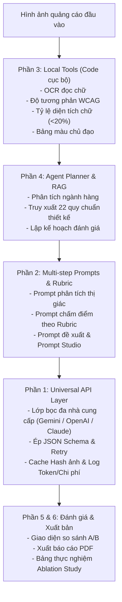

# KẾ HOẠCH & TIẾN ĐỘ TỔNG THỂ DỰ ÁN ADVISION AI (CẬP NHẬT ĐỒ ÁN TỐT NGHIỆP)

**Dự án:** AdVision - Hệ Thống Cố Vấn Thẩm Định Thị Giác Hình Ảnh Quảng Cáo  
**Sinh viên thực hiện:** Trần Thái Cương (MSSV: 2255010026)  
**Kiến trúc:** Compound AI System & Multi-Agent Architecture (SOA v2)  
**Cập nhật lần cuối:** 21/11/2026

---

## 1. ĐỊNH HƯỚNG CHIẾN LƯỢC: CHỨNG MINH KHỐI LƯỢNG ĐỒ ÁN

> [!IMPORTANT]
> **Giải quyết bài toán "Xây dựng" vs "Gọi API bên thứ ba":**  
> Hội đồng bảo vệ thường e ngại việc sinh viên "chỉ gọi API đơn giản". Để chứng minh tính khoa học và khối lượng kỹ thuật vượt trội, AdVision không đóng vai trò một wrapper đơn thuần, mà là một **Hệ thống AI phức hợp (Compound AI System)** kết hợp giữa:
> 1. **Local Computer Vision & Rule-based Tools (Phần tự xây dựng cục bộ 100%):** OCR bóc tách chữ, thuật toán đo tương phản WCAG 2.1, phân tích bảng màu chủ đạo (Color Palette Extraction), Saliency Map vùng nhìn.
> 2. **Kiến trúc Agentic AI có điều phối (Planner & RAG):** Độc lập truy xuất 22 quy chuẩn thiết kế, phân loại ngành hàng, chia nhỏ chuỗi tư duy (Multi-step Reasoning).
> 3. **Lớp trừu tượng API đa nhà cung cấp (Universal API Adapter):** Tự động chuyển đổi Gemini / OpenAI / Claude, ép chuẩn JSON Schema, cơ chế Retry/Backoff, Cache hash ảnh và giám sát token.
>
> 💡 **ĐỊNH HƯỚNG THIẾT KẾ CONVERSATIONAL AI CHUẨN MỰC (CLAUDE.AI & CHATGPT STYLE):**
> Hệ thống kiên định không chạy đua theo hướng nhồi nhét nhiều nút chức năng rườm rà trên thanh công cụ hay giao diện chat. Trải nghiệm người dùng được xây dựng tối giản, tinh tế như Claude.ai và ChatGPT:
> - Mọi luồng nghiệp vụ (từ tiếp nhận brief, thẩm định chuyên sâu, chấm điểm định lượng, so sánh A/B đến xuất báo cáo) đều được diễn ra hoàn toàn tự nhiên qua hội thoại ngôn ngữ đa lượt (Multi-turn Natural Conversation).
> - Tuyệt đối không spam hàng loạt nút bấm cứng trên màn hình. Chỉ khi người dùng thực sự giao tiếp và yêu cầu (ví dụ: *"cho mình xin báo cáo thẩm định", "tổng hợp kết quả gửi sếp", "xuất file pdf"*), AI Agent mới tổng hợp toàn bộ tri thức và đính kèm thẻ báo cáo chuyên nghiệp cùng nút in/lưu PDF sạch đẹp.

---

## 2. HIỆN TRẠNG HỆ THỐNG ĐÃ HOÀN THÀNH (BASELINE)

| Phân hệ | Đã hoàn thành | Chi tiết kỹ thuật |
| :--- | :---: | :--- |
| **Kiến trúc SOA v2** | ✅ 100% | Tách biệt `client/` (Frontend SPA), `server/` (Gateway & Router), `data/` (Rules & Users). |
| **Giao diện Claude.ai** | ✅ 100% | Bảng màu ấm (#FAF9F5, #181816, #DA7756), Collapsible Sidebar, Nút con mắt cố định góc trái, Theme Switcher (Hệ thống/Sáng/Tối). |
| **Xác thực Google** | ✅ 100% | Google OAuth 2.0, chuyển hướng Desktop Account Chooser, Token Client Mobile, phân định Guest vs User. |
| **Cơ sở dữ liệu máy khách** | ✅ 100% | IndexedDB (`AdVision_ClientDB`), lưu tối đa 10 phiên chat và ảnh Base64, tự động dọn dẹp, bảo mật đa người dùng độc lập. |
| **Trải nghiệm Deep Linking** | ✅ 100% | URL định danh `?c=sess-xxxx`, nút Back/Forward trình duyệt, Smart Auto-Naming tự đặt tên phiên chat theo ảnh/câu hỏi. |
| **Kịch bản Art Director** | ✅ 100% | 6 vòng hội thoại (Onboarding -> Briefing -> First Impression -> Deep-dive -> Actionable -> Prompt Studio). |

---

## 3. LỘ TRÌNH CHI TIẾT 6 PHẦN NÂNG CẤP (AGENTIC & LOCAL TOOLS)

### 📌 Phần 1: Lớp kết nối API đa nhà cung cấp & Giám sát (Đã hoàn thiện)
- [x] **Universal Engine Adapter:** Chuẩn hóa giao diện gọi phân tích hình ảnh và hội thoại đa lượt cho phép linh hoạt hoán đổi giữa Google Gemini và OpenAI GPT-4o.
- [x] **Cơ chế chịu lỗi (Fault Tolerance):** Retry với Exponential Backoff tự động khi gặp lỗi mạng/Rate limit (HTTP 429), tự động ưu tiên model phản hồi nhanh nhất.
- [x] **Tối ưu chi phí & Tốc độ:** Băm hash nhanh (Image Base64 + Prompt) theo cơ chế LRU Cache trong bộ nhớ, trả về kết quả ngay lập tức (0ms, 0 token) khi phân tích lại cùng ảnh.
- [x] **Giám sát & Quản lý Token (Profiler & Telemetry):** Tự động ghi nhận `latencyMs`, số lượng `promptTokens`, `candidatesTokenCount`, tổng token tiêu thụ và mô hình phục vụ trong từng phiên gọi API (`ApiService.getTelemetryLogs()`).

### 📌 Phần 2: Thiết kế Prompt đa bước & Bảng tiêu chí Rubric (Đã hoàn thiện cốt lõi)
- [x] **Grounding Dữ liệu Đo đạc thực tế:** Nhúng thông số Ground Truth từ tầng đo đạc cục bộ (WCAG 2.1, 60-30-10, diện tích chữ) vào `PersonaPrompt` để yêu cầu AI lập luận dựa trên bằng chứng khoa học cụ thể, triệt tiêu ảo giác.
- [x] **Xây dựng Rubric chấm điểm định lượng chuẩn hóa (`scoringService.js`):** Thiết lập thang điểm 1-10 kèm định nghĩa chi tiết cho 6 tiêu chí cốt lõi (Sức hút 2s đầu, Thông điệp, Phân cấp chữ, Bố cục & Khoảng trắng, Nhận diện thương hiệu, Điểm rơi CTA). Parser JSON schema bắt lỗi tự động, tính điểm trung bình có trọng số và gán kết luận Verdict (Xuất sắc / Tốt / Trung bình / Yếu).
- [x] **Tách nhỏ Prompt đa chặng (Multi-step Reasoning):** Tách biệt quy trình thành các bước độc lập: Tổng quan trực giác 2 giây đầu (`image_overview`) -> Chấm điểm Rubric 6 tiêu chí (`rubric_score`) -> Mổ xẻ điểm nghẽn chuyển đổi (`weaknesses`) -> Hướng dẫn kỹ thuật khắc phục (`actionable`) -> Tái thiết kế sinh Prompt Gen AI (`redesign_prompt`).
- [ ] **Few-shot Learning:** Tích hợp các ví dụ mẫu (ảnh đạt chuẩn vs ảnh vi phạm) vào ngữ cảnh.

### 📌 Phần 3: Bộ công cụ đo lường thị giác chạy cục bộ (Local Computer Vision Tools - Đã hoàn thiện cốt lõi)
*(Trọng tâm tạo khối lượng tự xây dựng của sinh viên, chứng minh đề tài không phải API wrapper đơn thuần)*
- [x] **Trích xuất bảng màu chủ đạo (K-Means Color Quantization 60-30-10):** Thuật toán tự bóc tách mã màu HEX và tỷ lệ % của Màu nền chính (60%), Màu cấu trúc/nhận diện (30%), và Màu điểm nhấn/nút CTA (10%) trực tiếp trên ma trận điểm ảnh canvas.
- [x] **Công cụ kiểm tra độ tương phản màu chuẩn WCAG 2.1:** Tính độ chói tương đối (Relative Luminance $L = 0.2126R + 0.7152G + 0.0722B$) và tỷ lệ tương phản giữa màu nhấn/chữ với màu nền, xác thực đạt hay không đạt chuẩn WCAG AA ($4.5:1$).
- [x] **Thuật toán ước tính mật độ diện tích chữ (Edge-density & Sobel Gradient):** Chia lưới khối $10 \times 10$, tính toán tỷ lệ % diện tích chữ/đồ họa tần số cao để đối chiếu với Quy tắc vàng 20% Text của Meta Ads.
- [x] **Thẻ đo đạc thị giác thời gian thực (Visual Telemetry Card):** Hiển thị trực quan 3 ô màu Hex, badge WCAG 2.1 và thước đo mật độ chữ ngay trong hộp thoại chat trước khi AI nhận xét.
- [ ] **OCR Engine cục bộ:** Mở rộng tích hợp thư viện OCR đọc văn bản trực tiếp trong trình duyệt để đếm chính xác số từ tiếng Việt.

### 📌 Phần 4: Kiến trúc Agent điều phối & RAG
- [ ] **Bộ lập kế hoạch (Agent Planner):** Tự động nhận diện tính chất ảnh để quyết định gọi công cụ cục bộ nào (ví dụ ảnh nhiều text thì ưu tiên OCR + WCAG).
- [ ] **Cơ chế RAG (Retrieval-Augmented Generation):** Đóng gói bộ 22 quy chuẩn thiết kế và chính sách quảng cáo của Meta/Google; truy xuất động đoạn quy chuẩn liên quan đưa vào System Prompt.
- [ ] **Vòng lặp tối ưu hóa (Optimization Loop):** Đánh giá -> Đề xuất sửa đổi -> Mô phỏng chỉnh sửa (crop/đổi màu) -> Chấm điểm lại vòng 2.

### 📌 Phần 5: Sản phẩm hoàn chỉnh & Công cụ hỗ trợ (Đã tích hợp chuẩn Conversational)
- [x] **Chế độ so sánh đối đầu A/B (`compare_ab`):** Khi người dùng nạp 2 hoặc nhiều ảnh cùng lúc, AI Agent tự động phân tích đối sánh 4 góc nhìn thị giác, tìm ra mẫu chiến thắng (Winner) và chỉ dẫn tối ưu CTR.
- [x] **Xuất báo cáo thẩm định qua hội thoại (Conversational PDF Export):** Người dùng chỉ cần trao đổi tự nhiên ("cho mình xin báo cáo", "xuất file pdf để gửi sếp"), Agent sẽ lập tức tổng hợp một bản Báo cáo Thẩm định Thị giác Chuyên sâu và gửi kèm thẻ in/lưu PDF chuẩn `@media print` ngay trong luồng chat. Không còn nút bấm thừa thãi trên UI.

### 📌 Phần 6: Khối thực nghiệm và Đánh giá (Evaluation & Ablation Study)
- [ ] **Thực nghiệm Ablation Study:**
  - Chế độ 1: Chỉ dùng VLM API thuần túy.
  - Chế độ 2: VLM API + Bộ công cụ cục bộ (OCR + WCAG + Color).
  - Chế độ 3: VLM API + Bộ công cụ cục bộ + RAG tri thức.
  - *Đo lường:* Độ chính xác phát hiện lỗi, độ dao động điểm số giữa các lần chạy, tỷ lệ ảo giác.
- [ ] **Benchmark hiệu năng:** Tỷ lệ JSON hợp lệ, độ trễ trung bình, chi phí token trên tập dữ liệu thử nghiệm 30-40 mẫu quảng cáo.

---

## 4. KẾ HOẠCH LÀM VIỆC TỪNG TUẦN

| Tuần | Hạng mục công việc trọng tâm | Sản phẩm đầu ra |
| :---: | :--- | :--- |
| **Tuần 1** | **Xây dựng Lớp bọc Universal API & JSON Schema** | Mô-đun adapter đa nhà cung cấp, ép JSON schema, retry, cache hash ảnh, log token |
| **Tuần 2** | **Thiết kế Rubric chấm điểm & Bộ Prompt đa bước** | Bộ Rubric 6 tiêu chí, chia chặng Prompt phân tích - đánh giá - đề xuất, few-shot samples |
| **Tuần 3** | **Xây dựng Bộ công cụ đo lường thị giác cục bộ** | Module đo WCAG Contrast, tính % diện tích chữ, bóc tách bảng màu chủ đạo |
| **Tuần 4** | **Tích hợp Agent Planner & Kết nối Local Tools vào Prompt** | Planner tự động chạy công cụ cục bộ và nhúng thông số thực tế vào VLM Prompt |
| **Tuần 5** | **Xây dựng cơ chế RAG 22 quy chuẩn thiết kế** | Module RAG truy xuất chính sách và quy tắc thiết kế theo ngành hàng |
| **Tuần 6** | **Chế độ so sánh A/B & Xuất báo cáo PDF** | Giao diện so sánh 2 ảnh song song, tính năng export PDF báo cáo |
| **Tuần 7** | **Thực hiện thực nghiệm, Ablation Study & Đo lường** | Bảng số liệu so sánh có tool vs không tool, đo độ ổn định điểm số |
| **Tuần 8** | **Đồng bộ toàn diện Báo cáo Đồ án tốt nghiệp & Slide** | Cập nhật Chương 2, Chương 3, Chương 4; hoàn thiện slide bảo vệ |
