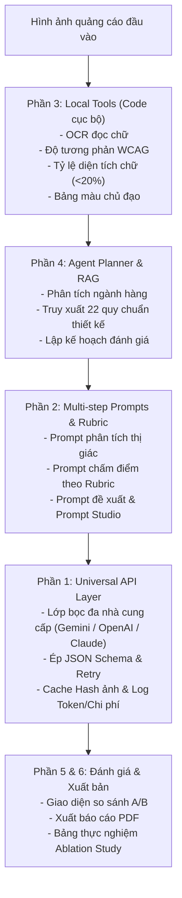

# KẾ HOẠCH & TIẾN ĐỘ TỔNG THỂ DỰ ÁN ADVISION AI (CẬP NHẬT ĐỒ ÁN TỐT NGHIỆP)

**Dự án:** AdVision - Hệ Thống Cố Vấn Thẩm Định Thị Giác Hình Ảnh Quảng Cáo  
**Sinh viên thực hiện:** Trần Thái Cương (MSSV: 2255010026)  
**Kiến trúc:** Compound AI System & Multi-Agent Architecture (SOA v2)  
**Cập nhật lần cuối:** 21/11/2026

---

## 1. ĐỊNH HƯỚNG CHIẾN LƯỢC: CHỨNG MINH KHỐI LƯỢNG ĐỒ ÁN

> [!IMPORTANT]
> **Giải quyết bài toán "Xây dựng" vs "Gọi API bên thứ ba":**  
> Hội đồng bảo vệ thường e ngại việc sinh viên "chỉ gọi API đơn giản". Để chứng minh tính khoa học và khối lượng kỹ thuật vượt trội, AdVision không đóng vai trò một wrapper đơn thuần, mà là một **Hệ thống AI phức hợp (Compound AI System)** kết hợp giữa:
> 1. **Local Computer Vision & Rule-based Tools (Phần tự xây dựng cục bộ 100%):** OCR bóc tách chữ, thuật toán đo tương phản WCAG 2.1, phân tích bảng màu chủ đạo (Color Palette Extraction), Saliency Map vùng nhìn.
> 2. **Kiến trúc Agentic AI có điều phối (Planner & RAG):** Độc lập truy xuất 22 quy chuẩn thiết kế, phân loại ngành hàng, chia nhỏ chuỗi tư duy (Multi-step Reasoning).
> 3. **Lớp trừu tượng API đa nhà cung cấp (Universal API Adapter):** Tự động chuyển đổi Gemini / OpenAI / Claude, ép chuẩn JSON Schema, cơ chế Retry/Backoff, Cache hash ảnh và giám sát token.

---

## 2. HIỆN TRẠNG HỆ THỐNG ĐÃ HOÀN THÀNH (BASELINE)

| Phân hệ | Đã hoàn thành | Chi tiết kỹ thuật |
| :--- | :---: | :--- |
| **Kiến trúc SOA v2** | ✅ 100% | Tách biệt `client/` (Frontend SPA), `server/` (Gateway & Router), `data/` (Rules & Users). |
| **Giao diện Claude.ai** | ✅ 100% | Bảng màu ấm (#FAF9F5, #181816, #DA7756), Collapsible Sidebar, Nút con mắt cố định góc trái, Theme Switcher (Hệ thống/Sáng/Tối). |
| **Xác thực Google** | ✅ 100% | Google OAuth 2.0, chuyển hướng Desktop Account Chooser, Token Client Mobile, phân định Guest vs User. |
| **Cơ sở dữ liệu máy khách** | ✅ 100% | IndexedDB (`AdVision_ClientDB`), lưu tối đa 10 phiên chat và ảnh Base64, tự động dọn dẹp, bảo mật đa người dùng độc lập. |
| **Trải nghiệm Deep Linking** | ✅ 100% | URL định danh `?c=sess-xxxx`, nút Back/Forward trình duyệt, Smart Auto-Naming tự đặt tên phiên chat theo ảnh/câu hỏi. |
| **Kịch bản Art Director** | ✅ 100% | 6 vòng hội thoại (Onboarding -> Briefing -> First Impression -> Deep-dive -> Actionable -> Prompt Studio). |

---

## 3. LỘ TRÌNH CHI TIẾT 6 PHẦN NÂNG CẤP (AGENTIC & LOCAL TOOLS)

### 📌 Phần 1: Lớp kết nối API đa nhà cung cấp & Giám sát
- [ ] **Universal Engine Adapter:** Chuẩn hóa giao diện gọi `analyze({ image, prompt, schema, provider })` cho phép hoán đổi Gemini 2.5 / OpenAI GPT-4o / Claude 3.5 chỉ bằng config.
- [ ] **Ép định dạng đầu ra có cấu trúc (Strict JSON Schema):** Kiểm tra cấu trúc JSON trả về, cơ chế tự động sửa lỗi (Self-healing retry) nếu mô hình trả về sai định dạng.
- [ ] **Cơ chế chịu lỗi (Fault Tolerance):** Retry với Exponential Backoff, xử lý Rate Limit, Timeout 30s, tự động fallback sang mô hình phụ khi mô hình chính quá tải.
- [ ] **Tối ưu chi phí & Tốc độ:** Băm hash SHA-256 (Image + Prompt) để cache kết quả; nén/resize ảnh thông minh trước khi gửi.
- [ ] **Giám sát & Quản lý Token:** Ghi nhận và hiển thị độ trễ (latency ms), số token in/out, chi phí ước tính mỗi phiên.

### 📌 Phần 2: Thiết kế Prompt đa bước & Bảng tiêu chí Rubric
- [ ] **Xây dựng Rubric chấm điểm định lượng:** Thiết lập thang điểm 1-10 kèm định nghĩa cụ thể cho 6 tiêu chí (Sức hút 2s đầu, Thông điệp, Phân cấp chữ, Bố cục & Khoảng trắng, Nhận diện thương hiệu, Điểm rơi CTA).
- [ ] **Tách nhỏ Prompt đa chặng (Multi-step Reasoning):** Thay vì một prompt khổng lồ, chia thành:
  - *Chặng 1:* Bóc tách thực thể và thông số thị giác.
  - *Chặng 2:* Đối chiếu quy chuẩn và chấm điểm theo Rubric.
  - *Chặng 3:* Đề xuất hành động kỹ thuật & sinh prompt vẽ lại.
- [ ] **Few-shot Learning:** Tích hợp 2-3 cặp ví dụ mẫu (ảnh đạt vs ảnh lỗi) vào ngữ cảnh để định hướng câu trả lời.
- [ ] **Giảm thiểu ảo giác (Grounding):** Yêu cầu AI chỉ ra tọa độ/vị trí tương đối trong ảnh khi đưa ra nhận xét.

### 📌 Phần 3: Bộ công cụ đo lường thị giác chạy cục bộ (Local Computer Vision Tools)
*(Trọng tâm tạo khối lượng tự xây dựng của sinh viên)*
- [ ] **OCR Engine cục bộ:** Tích hợp mô hình OCR đọc văn bản trong ảnh (kể cả tiếng Việt) để tính toán chính xác số lượng từ và nội dung chữ.
- [ ] **Thuật toán tỷ lệ diện tích chữ (Text-to-Image Area Ratio):** Tính toán % diện tích chữ chiếm trên toàn bức ảnh (đối chiếu quy tắc vàng 20% Text của quảng cáo).
- [ ] **Công cụ kiểm tra độ tương phản màu chuẩn WCAG 2.1:** Đo tỷ lệ tương phản (Contrast Ratio) giữa màu chữ và màu nền (đảm bảo đạt chuẩn tối thiểu 4.5:1).
- [ ] **Trích xuất bảng màu chủ đạo (Dominant Color Palette):** Sử dụng K-Means Clustering để bóc tách 3-5 màu chính của ấn phẩm và tính độ hài hòa màu sắc (Color Harmony).

### 📌 Phần 4: Kiến trúc Agent điều phối & RAG
- [ ] **Bộ lập kế hoạch (Agent Planner):** Tự động nhận diện tính chất ảnh để quyết định gọi công cụ cục bộ nào (ví dụ ảnh nhiều text thì ưu tiên OCR + WCAG).
- [ ] **Cơ chế RAG (Retrieval-Augmented Generation):** Đóng gói bộ 22 quy chuẩn thiết kế và chính sách quảng cáo của Meta/Google; truy xuất động đoạn quy chuẩn liên quan đưa vào System Prompt.
- [ ] **Vòng lặp tối ưu hóa (Optimization Loop):** Đánh giá -> Đề xuất sửa đổi -> Mô phỏng chỉnh sửa (crop/đổi màu) -> Chấm điểm lại vòng 2.

### 📌 Phần 5: Sản phẩm hoàn chỉnh & Công cụ hỗ trợ
- [ ] **Chế độ so sánh đối đầu A/B (Side-by-Side Comparison):** Cho phép tải 2 bức ảnh banner cùng lúc, hiển thị bảng so sánh điểm trực tiếp xem mẫu nào tối ưu chuyển đổi hơn.
- [ ] **Xuất báo cáo thẩm định (PDF Export):** Nút tải báo cáo chuyên nghiệp chuẩn PDF có đầy đủ điểm số, nhận xét và đề xuất kỹ thuật.

### 📌 Phần 6: Khối thực nghiệm và Đánh giá (Evaluation & Ablation Study)
- [ ] **Thực nghiệm Ablation Study:**
  - Chế độ 1: Chỉ dùng VLM API thuần túy.
  - Chế độ 2: VLM API + Bộ công cụ cục bộ (OCR + WCAG + Color).
  - Chế độ 3: VLM API + Bộ công cụ cục bộ + RAG tri thức.
  - *Đo lường:* Độ chính xác phát hiện lỗi, độ dao động điểm số giữa các lần chạy, tỷ lệ ảo giác.
- [ ] **Benchmark hiệu năng:** Tỷ lệ JSON hợp lệ, độ trễ trung bình, chi phí token trên tập dữ liệu thử nghiệm 30-40 mẫu quảng cáo.

---

## 4. KẾ HOẠCH LÀM VIỆC TỪNG TUẦN

| Tuần | Hạng mục công việc trọng tâm | Sản phẩm đầu ra |
| :---: | :--- | :--- |
| **Tuần 1** | **Xây dựng Lớp bọc Universal API & JSON Schema** | Mô-đun adapter đa nhà cung cấp, ép JSON schema, retry, cache hash ảnh, log token |
| **Tuần 2** | **Thiết kế Rubric chấm điểm & Bộ Prompt đa bước** | Bộ Rubric 6 tiêu chí, chia chặng Prompt phân tích - đánh giá - đề xuất, few-shot samples |
| **Tuần 3** | **Xây dựng Bộ công cụ đo lường thị giác cục bộ** | Module đo WCAG Contrast, tính % diện tích chữ, bóc tách bảng màu chủ đạo |
| **Tuần 4** | **Tích hợp Agent Planner & Kết nối Local Tools vào Prompt** | Planner tự động chạy công cụ cục bộ và nhúng thông số thực tế vào VLM Prompt |
| **Tuần 5** | **Xây dựng cơ chế RAG 22 quy chuẩn thiết kế** | Module RAG truy xuất chính sách và quy tắc thiết kế theo ngành hàng |
| **Tuần 6** | **Chế độ so sánh A/B & Xuất báo cáo PDF** | Giao diện so sánh 2 ảnh song song, tính năng export PDF báo cáo |
| **Tuần 7** | **Thực hiện thực nghiệm, Ablation Study & Đo lường** | Bảng số liệu so sánh có tool vs không tool, đo độ ổn định điểm số |
| **Tuần 8** | **Đồng bộ toàn diện Báo cáo Đồ án tốt nghiệp & Slide** | Cập nhật Chương 2, Chương 3, Chương 4; hoàn thiện slide bảo vệ |
